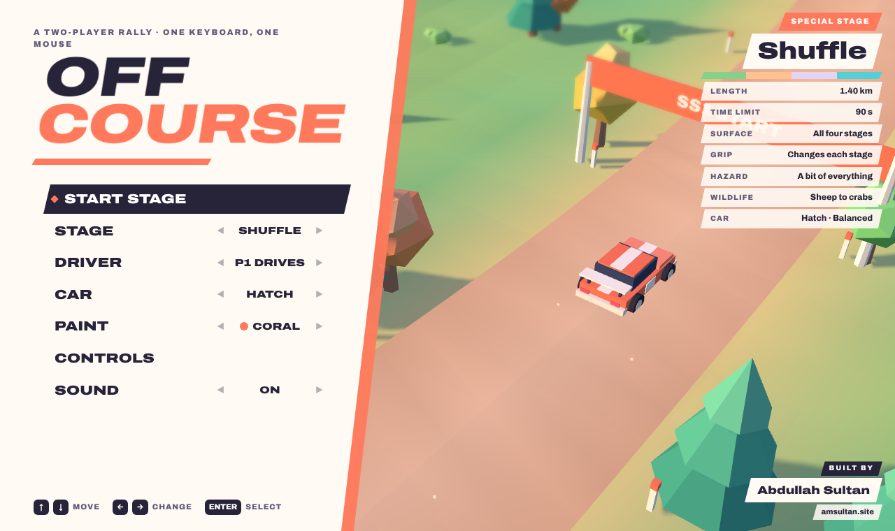
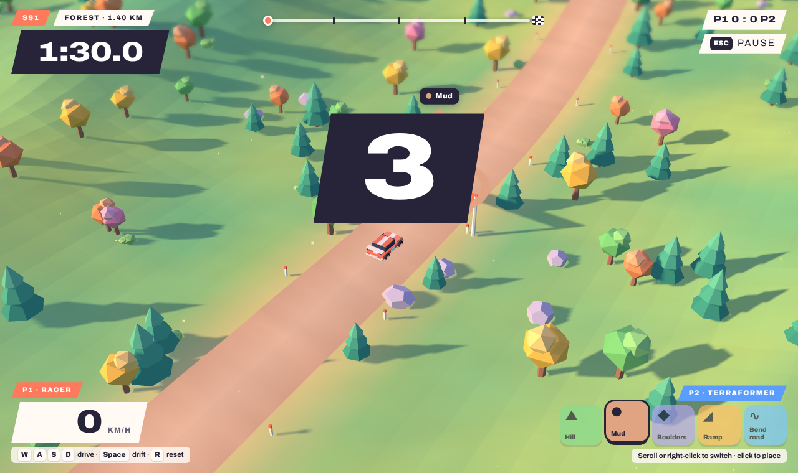

# Off Course

A two-player rally game in the browser. One player drives the car to the finish. The other player controls the land and tries to stop them.

Built by [Abdullah Sultan](https://www.amsultan.site).

## How to play

Two people share one computer. The racer uses the keyboard, and the terraformer uses the mouse.

- The **racer** has 90 seconds to reach the finish line. Making it in time wins the stage.
- The **terraformer** reshapes the stage in real time. If the clock runs out, the terraformer wins the stage.
- Every so often the stage does something ridiculous on its own: a meteor shower, a tornado, moon gravity, an earthquake, or an animal stampede.
- Roles swap after each stage by default. You can also pick who drives from the menu.

## Controls

**Racer (keyboard)**

| Key | Action |
|---|---|
| W / S | Gas / brake |
| A / D | Steer |
| Space | Handbrake drift (use it on the square corners) |
| R | Back on the road (costs 2 seconds) |

**Terraformer (mouse)**

| Input | Action |
|---|---|
| Move | Aim the cursor |
| Scroll or right-click | Switch tool |
| Left click | Place the tool |

The five tools are Hill, Mud, Boulders, Ramp, and Bend road. Each has its own cooldown.

**Menus:** ↑ ↓ to move, ← → to change a setting, Enter to select, Esc to go back or pause.

## Stages and cars

- **Stages:** Forest, Desert (loose sand), Snow (icy grip), and Coast (don't drive into the ocean). Shuffle rotates through all four.
- **Cars:** Hatch (balanced), Wedge (fast and twitchy), Buggy (barely slowed off-road), and Van (keeps its speed through trees).
- **Paint:** 8 colors. Your car and paint are saved in your browser.

## Running it

**Play it at [off-course-game.vercel.app](https://off-course-game.vercel.app).**

The whole game lives in `index.html`; the other files at the root are the favicon, app icons, and web manifest. To run it locally, open `index.html` in a browser. There's no build step.

The site is deployed on Vercel as a static site with no framework, and every push to `main` deploys automatically.

### Analytics

The site uses [Vercel Web Analytics](https://vercel.com/docs/analytics) through the plain HTML snippet in `index.html`. The script only loads when the site is deployed on Vercel with Web Analytics enabled for the project. Opened locally, the request 404s and nothing breaks.

The game loads [three.js](https://threejs.org/) r128 from cdnjs and the Archivo font from Google Fonts, so it needs an internet connection the first time it loads.
